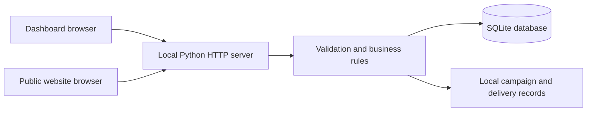

# How Launchpad works

The application intentionally uses a small stack: the Python standard library, SQLite and browser JavaScript. You can read and maintain it without a build pipeline or a front-end framework.

## A request through the system

`server.py` starts the application and accepts command-line options. `hub/routes.py` handles HTTP: it serves the pages, reads JSON requests, checks the local request boundary and returns JSON results. `hub/application.py` implements the company-scoped business rules and API dispatch, `hub/storage.py` holds the schema and transaction helper, and `hub/validation.py` provides reusable input checks.

The dashboard loads its session and uses `/api/companies/{companyId}/...` routes. The public website uses `/api/public/{slug}/...` routes. The browser sends data; the server decides what is valid and which company owns it. A JavaScript filter is never the source of company isolation.

The contract in `CONTRACT.md` lists the API fields and routes. Use it alongside the implementation when adding features, and update both when you change the shared API.

## Company scope

A company ID identifies the business owning a record. A company slug identifies its public website. Leads, services, bookings, posts, campaigns, deliveries and activity belong to a company.

When adding or changing a database query, include the company ID in its condition. When updating a resource by ID, verify that the resource belongs to the company from the route. An ID alone is not sufficient permission to read or update it.

The company selector is intended for a local operator. There is no signed-in user or membership table in this version. A future hosted version must determine the user's allowed companies on the server before returning a session or processing a company request.

## Storage and timestamps

SQLite persists the application state in `data/business-hub.sqlite3`. SQL and Python use `snake_case`; JSON consumed by the browser uses `camelCase`.

Date-time values use ISO format with time-zone offsets. Appointment availability uses the company's business timezone and opening schedule. The demo defaults to `Africa/Johannesburg`, with prices in ZAR. Monetary fields are amounts in currency units, not cents.

Example records are inserted only on a fresh database. They are synthetic and use placeholder contact addresses. Demonstration statistics are calculated from saved records, rather than being a separate stream of fabricated analytics.

## Booking rules

The public website asks the server for slots for a service and date. The service's duration determines each appointment's end time. Slots must be in the future, on an open business day, inside opening hours and clear of requested or confirmed appointments.

The server checks the conditions again when creating a booking; seeing a slot in the browser does not reserve it. A transaction makes the availability check and booking insert one operation. If two visitors request overlapping time, one receives a booking and the other receives HTTP `409`.

Cancelled appointments no longer hold their time. Status changes must also respect conflicts when returning an appointment to a reserving state. A booking creates an associated lead so the operator can follow up and track its outcome.

## Website drafts and publication

Website copy has two versions: `draft` and `published`. Saving changes edits the draft; pressing publish replaces the public version. Public API responses expose the published version and active services, along with content published to the local website.

Keep this distinction when extending the website. A visitor should not see a half-finished headline simply because an operator saved it in the dashboard.

## Content and campaign preparation

A post holds shared copy and selected channels. Website delivery publishes locally. External social channels produce `demo_ready` delivery records because provider accounts are not connected.

Published website posts have a saved public copy. Editing a post creates a draft without changing that public copy; **Prepare & publish** replaces it. Removing the website from a draft's selected channels also leaves its public copy in place until that draft is explicitly published again. Publishing the post with only social channels then removes its website copy. Company exports include both editable `posts` and their `publishedPosts` snapshots.

A campaign records its objective, offer, planned budget, selected channels and source code. Running it prepares an associated post and delivery records. The preparation is idempotent: repeating the same action must not multiply posts or deliveries.

Campaign source codes can be used in the public website query string and submitted with an enquiry or booking. The server checks the source code against the same company before using it for lead attribution.

## Leads and conversion figures

The statuses are `new`, `contacted`, `qualified`, `won` and `lost`. A lead's saved value and commission rate are operator-entered estimates. Commission rates are percentages from 0 to 100; a won lead with a value of R1,250 and an 8% rate contributes R100 to estimated commission. Won leads contribute to converted value; new, contacted and qualified leads contribute to pipeline value. New companies default to a 0% commission rate, while the seeded Juniper Studio example uses 5%.

These records are useful for demonstrating a referral workflow. Real financial reporting will require an agreed event that counts as a conversion, evidence from the client or provider, and a separate distinction between expected and paid commission.

## Local request boundary

The HTTP server listens on `127.0.0.1`. It rejects unexpected request hosts and cross-origin writes. Dashboard writes require the session's `X-CSRF-Token`; public forms use their own validation and submission limits. JSON size limits and field validation apply on the server.

These checks complement each other. An origin check restricts browser-initiated writes; a token protects dashboard actions; field validation protects the data model. They do not create user accounts or authorize different staff members.

## Changing the code safely

1. Find the corresponding route in `CONTRACT.md` and the browser function that calls it.
2. Add validation and business logic in the Python package, including company scope.
3. Update the HTTP route or response only when the API needs to change.
4. Update the browser and the contract together.
5. Run the integration tests and exercise the relevant dashboard or public form.

Comments should explain a rule or decision. Prefer a descriptive function name and a short, direct body over a compact expression that hides several operations.
